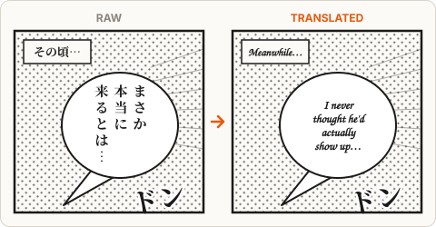
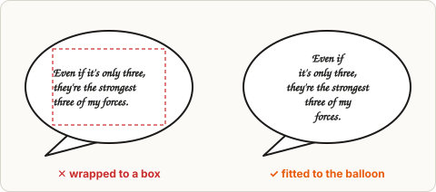
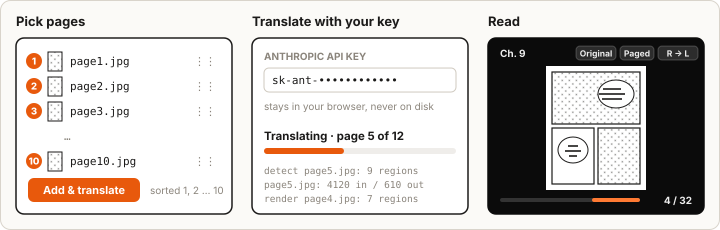
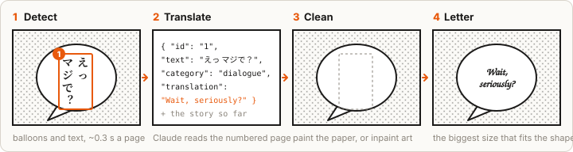

<div align="center">

<picture>
  <source media="(prefers-color-scheme: dark)" srcset="docs/readme/logo-dark.svg"/>
  
</picture>

**Raw manga in, lettered English out. Self-hosted, with your own API key.**

<a href="https://www.python.org/downloads/"></a> <a href="#run-it-with-docker"></a> <a href="https://docs.anthropic.com"></a> <a href="#license"></a>

[Quick start](#quick-start) · [Web UI](#the-web-ui) · [CLI](#the-cli) · [How it works](#how-it-works) · [License](#license)

</div>

## Balloons, not boxes

It finds every balloon and caption and reads them in order with the whole page in view. It wipes only the Japanese, so screentone and art stay untouched, and letters the English back into the balloon's real shape. Sound effects stay as drawn art unless you ask otherwise.



## Lettering that fits the balloon

Each line gets the width the balloon has at that height, so text forms the centred lozenge a letterer would set. Breaks avoid leaving "the" or a lonely word at a line end. If a line can't fit, the translator's own shorter version is used instead of shrinking the text to nothing.



## Pick pages, translate, read

Select a chapter's pages in the file picker. They line up as page1, page2 … page10, and you can drag to reorder. Paste your Anthropic key and press translate. Then read in the built-in reader: paged right-to-left or vertical scroll, with <kbd>O</kbd> to peek at the original.



## Quick start

```sh
git clone https://github.com/xuckless/manga-translator && cd manga-translator
python -m venv venv && source venv/bin/activate
pip install -r requirements.txt
python -m manga_translator serve          # http://127.0.0.1:8000
```

Create a chapter, add its pages, put your key in **Settings**, press **Translate**. The detector (~170 MB) and LaMa (~200 MB) download from Hugging Face on first use.

### Run it with Docker

```sh
MANGA_TRANSLATOR_TOKEN=change-me docker compose up -d --build
```

The image is CPU-only. Chapters live in `./data/chapters`, and model weights live in a named volume.

## The web UI

- **Your key stays yours.** It is kept in your browser and sent only when a translation starts. The server holds it in memory for that job and never writes it to disk. A server-wide `ANTHROPIC_API_KEY` works too.
- **Review before you read.** Click a page: numbered boxes on the art match a list of transcriptions and translations. Fix a line or mark a box as `noise` (leave it alone), then <kbd>Save & re-letter page</kbd>.
- **Context carries over.** Each page is translated with the story so far and a glossary of names, so pages you add later keep the same voices.
- **Options per chapter:** model (Opus, Sonnet, Haiku), effort, honorifics (`-sama` or "Lord"), font, ALL CAPS, sound effects, LaMa or OpenCV clean-up. **Re-letter** applies them again with no API calls.
- **On a server or LAN**, require a token:

```sh
python -m manga_translator serve --host 0.0.0.0 --token "$(openssl rand -hex 16)"
```

## The CLI

The CLI works on the same chapter folders as the UI, so either can pick up where the other stopped.

```sh
python -m manga_translator run       data/chapters/chapter-9     # detect + translate + letter
python -m manga_translator detect    data/chapters/chapter-9
python -m manga_translator translate data/chapters/chapter-9 --model claude-sonnet-5-5 --effort medium
python -m manga_translator render    data/chapters/chapter-9 --debug   # mask overlays in work/debug/
```

A chapter is a folder of page images. `work/chapter.json` holds every detection and translation and is safe to edit by hand. No API key? `translate --backend manual` writes each marked page and its prompt so that any model or person can answer. Re-run the command to import the answers.

## How it works



<details>
<summary>Each step in detail</summary>

| Step | What happens | Why this way |
| --- | --- | --- |
| **Detect** | [`comic-text-and-bubble-detector`](https://huggingface.co/ogkalu/comic-text-and-bubble-detector) (RT-DETR-v2) finds balloons, text inside balloons and text over art. Each balloon's real interior is traced from the image, so ovals, spikes and clouds keep their shape. | Vision LLMs are poor at pixel coordinates. A dedicated detector gets the geometry right. |
| **Translate** | Regions are drawn on the page as numbered marks. Claude returns structured JSON per mark: transcription, translation, a shorter fallback, a category and the reading order. | The model does what it is good at: reading and translating with the whole page and story in view. |
| **Clean** | On flat paper, the text is painted over with the paper colour. Text over art and screentone balloons is inpainted with LaMa (ONNX, CPU). | A plain fill is perfect on paper. LaMa rebuilds hatching and tone. |
| **Letter** | It picks the largest size whose layout fits the balloon's shape, balances lines with a small dynamic program, and keeps sizes consistent across the page. | It gives the professional lozenge look without hand-tuned wrapping. |

</details>

## Develop

```sh
pytest                                    # typesetting tests
python -m manga_translator serve --library /tmp/test-library
```

The UI is FastAPI plus plain JavaScript in `manga_translator/web/`, with no build step. `legacy/` keeps the first prototype and the reasons for the rewrite.

## License

[MIT](LICENSE-MIT) or [Apache-2.0](LICENSE-APACHE), at your option. Comic Neue (`assets/fonts/`) is under the SIL OFL. The detector and LaMa weights are Apache-2.0 and are downloaded at runtime. Pages you translate are not covered by this license, so only translate what you have the right to.
